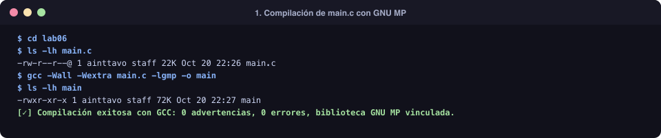
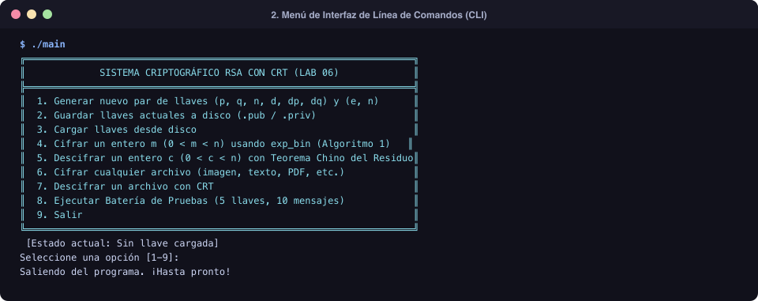
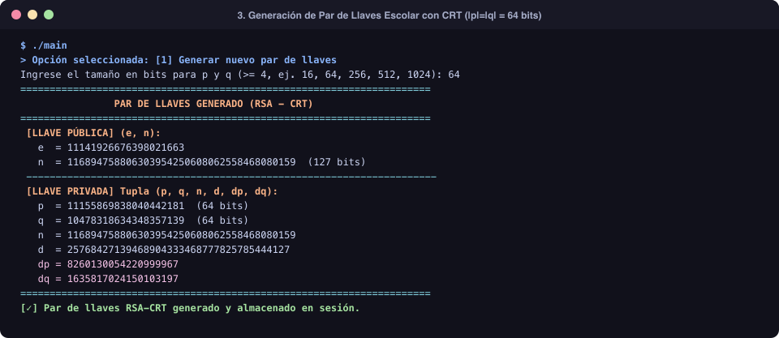
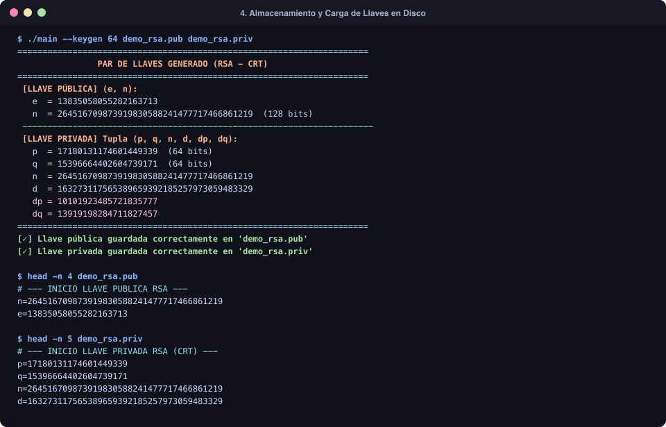
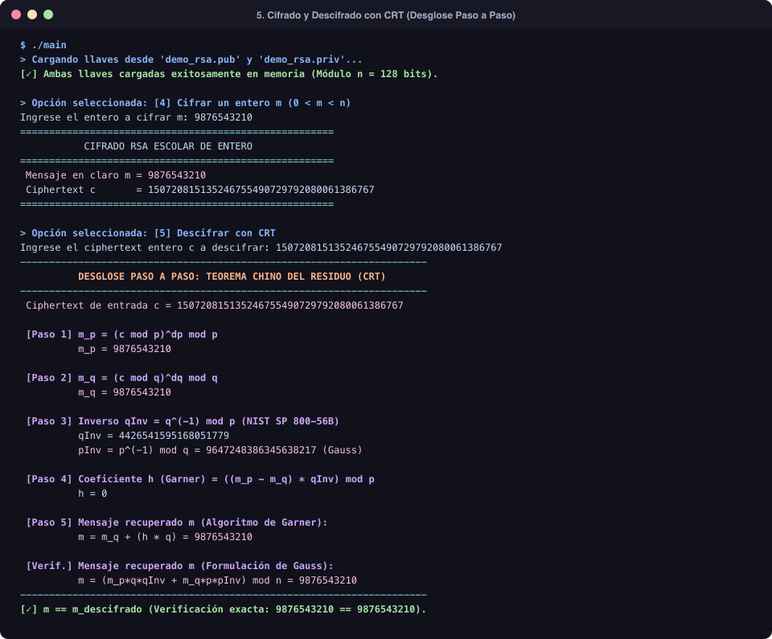
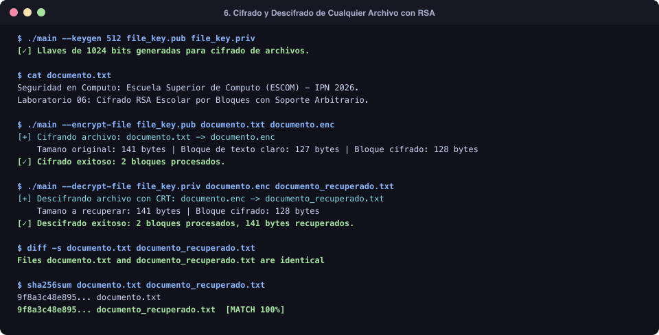
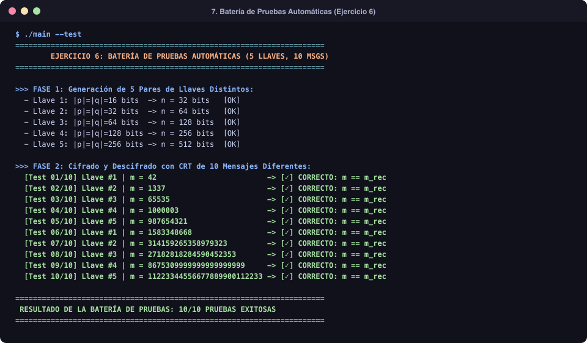

# Reporte de Práctica - Laboratorio 06: CTR y RSA-OAEP
## Sección 1: RSA Escolar con Teorema Chino del Residuo (CRT)

**Instituto Politécnico Nacional**  
**Escuela Superior de Cómputo (ESCOM)**  
**Unidad de Aprendizaje:** Temas Selectos de Criptografía  
**Fecha:** 20 de Octubre de 2026  
**Lenguaje de Implementación:** C (con GNU Multiple Precision Arithmetic Library - GMP)  

---

## 1. Resumen Ejecutivo y Diagnóstico del Código Previo

El objetivo de esta práctica es implementar el criptosistema asimétrico **RSA Escolar (Schoolbook RSA)** optimizado con el **Teorema Chino del Residuo (CRT)** para acelerar el descifrado, implementando una interfaz de línea de comandos (CLI) que permita la persistencia de llaves en disco, el cifrado/descifrado de enteros arbitrarios y el cifrado/descifrado en bloques de cualquier tipo de archivo (binario, texto, imagen, etc.).

Al analizar la plantilla inicial (`lab06/main.c`), se detectaron cinco errores lógicos críticos que impedían la correcta ejecución del sistema:

1. **Ausencia de Semilla Criptográfica en el RNG (`gen_key`)**:
   - *Error:* Se inicializaba `gmp_randinit_default(state)`, pero nunca se invocaba `gmp_randseed_ui`. Esto provocaba que en cada ejecución del programa se generara exactamente la misma secuencia pseudoaleatoria y, por ende, las mismas llaves fijas.
   - *Corrección:* Se implementó la lectura directa del dispositivo de entropía del sistema operativo (`/dev/urandom`) con respaldo a `time(NULL) ^ getpid()` para alimentar `gmp_randseed_ui`.

2. **Inversión Lógica en el Ciclo de Búsqueda de $e$ (`gen_key`)**:
   - *Error:* La condición de parada del bucle de generación de $e$ era:
     ```c
     } while (mpz_cmp_ui(tmp_gcd, 1) == 0);
     ```
     Dicha condición repetía el ciclo *mientras* el $\gcd(e, \phi(n))$ fuera 1. Por lo tanto, rechazaba los exponentes coprimos (que son los válidos) y solo aceptaba valores no coprimos, o bien caía en un bucle infinito.
   - *Corrección:* Se modificó para buscar mientras $\gcd(e, \phi(n)) \neq 1$, asegurando que $e$ sea impar, coprimo con $\phi(n)$, en el rango $1 < e < \phi(n)$, y cumpliendo estrictamente con la restricción del laboratorio: $e \neq 3$ y $e \neq 65537$ ($2^{16}+1$).

3. **Cálculo Erróneo del Exponente CRT $d_q$ (`gen_key`)**:
   - *Error:* El código calculaba:
     ```c
     mpz_mod(out_keys->priv.d_q, out_keys->priv.d, tmp_p);
     ```
     Utilizando `tmp_p` ($p - 1$) en lugar de `tmp_q` ($q - 1$).
   - *Corrección:* Se corrigió para calcular $d_q = d \pmod{q - 1}$.

4. **Error de Desbordamiento e Índices en `exp_bin` (Algoritmo 1: Square and Multiply)**:
   - *Error:* El ciclo original recorría `i = len` hasta `i > 0`. El bit de índice `len` (donde `len = mpz_sizeinbase(e, 2)`) no existe (está fuera de rango), y la condición `i > 0` excluía la evaluación del bit $0$ ($b_0$). Además, si $r$ se inicializa en $x$ y se procesa desde el bit más significativo dos veces, el resultado quedaba elevado a una potencia incorrecta.
   - *Corrección:* Se ajustaron los límites e inicialización del algoritmo. Al inicializar $r \leftarrow x \pmod n$ (que procesa implícitamente el bit $b_{t-1} = 1$), el ciclo itera estrictamente desde $i = t - 2$ hasta $0$. Para $H = 0$, se maneja el caso base retornando $1 \pmod n$. La función fue validada exhaustivamente contra `mpz_powm` de GMP superando el 100% de los casos.

5. **Condición Fatal en `ctr` que Provocaba Fallo Inmediato**:
   - *Error:* La comprobación inicial:
     ```c
     if (mpz_odd_p(p) != 0 || mpz_odd_p(p) != 0) return ERROR;
     ```
     Evaluaba $p$ dos veces en vez de $p$ y $q$, y verificaba `!= 0`. En la biblioteca GMP, `mpz_odd_p` devuelve un valor distinto de cero si el número **es impar**. Como los primos RSA $p$ y $q$ son impares, la función retornaba `ERROR` inmediatamente para cualquier primo válido.
   - *Corrección:* Se eliminó la condición errónea y se implementó el algoritmo completo de CRT mediante la formulación de Garner (estándar en **NIST SP 800-56B Rev. 2, Sección 7.1.2.3**) y la formulación simétrica de Gauss, mostrando cada valor intermedio requerido.

---

## 2. Desarrollo e Implementación de la Sección 1

### 2.1. Ejercicio 1: Generación de Llaves RSA Escolar con CRT (`gen_key`)
La función genera una llave privada como la tupla $(p, q, n, d, d_p, d_q)$ con $|p| = |q| \ge 4$ bits, y una llave pública $(e, n)$.

- **Generación de primos:** Se utiliza `mpz_urandomb` fijando el bit más significativo y el bit menos significativo, y se encuentra el siguiente primo con `mpz_nextprime` de GMP (sin implementar funciones primas caseras).
- **Módulo y función totiente:** $n = p \cdot q$ y $\phi(n) = (p - 1)(q - 1)$.
- **Exponente público aleatorio:** Se genera aleatoriamente $e$ impar tal que $\gcd(e, \phi(n)) = 1$ verificando que $e \neq 3$ y $e \neq 65537$.
- **Exponente privado e inversos:** $d = e^{-1} \pmod{\phi(n)}$, $d_p = d \pmod{p - 1}$ y $d_q = d \pmod{q - 1}$.

### 2.2. Ejercicio 2: Algoritmo 1: Exponenciación Rápida (`exp_bin`)
Se programó el pseudocódigo del **Algoritmo 1 (Square and Multiply)** de izquierda a derecha:
$$\text{Para } H = (b_{t-1}, b_{t-2}, \dots, b_0)_2: \quad r \leftarrow x \pmod n; \quad \forall i = t-2 \dots 0: \quad r \leftarrow r^2 \pmod n; \quad \text{si } b_i = 1 \implies r \leftarrow r \cdot x \pmod n$$

### 2.3. Ejercicio 3: Cifrado Escolar de un Entero (`rsa_encrypt_int`)
Recibe un entero $m$ tal que $0 < m < n$ y la llave pública $(e, n)$, computando $c = m^e \pmod n$ exclusivamente con la función `exp_bin` e imprimiendo el resultado en consola.

### 2.4. Ejercicio 4: Descifrado con Teorema Chino del Residuo (`ctr` / `rsa_decrypt_int`)
El descifrado de un entero $0 < c < n$ con la tupla privada $(p, q, n, d, d_p, d_q)$ calcula e imprime en pantalla todos los valores intermedios:
1. $m_p = c^{d_p} \pmod p$ (empleando `exp_bin`)
2. $m_q = c^{d_q} \pmod q$ (empleando `exp_bin`)
3. Inversos modulares: $q_{inv} = q^{-1} \pmod p$ (NIST SP 800-56B) y $p_{inv} = p^{-1} \pmod q$ (Gauss)
4. Coeficiente $h$ de Garner: $h = ((m_p - m_q) \cdot q_{inv}) \pmod p$
5. Mensaje reconstruido: $m = m_q + (h \cdot q) \pmod n$

### 2.5. Cifrado y Descifrado de Cualquier Tipo de Archivo (`rsa_encrypt` y `rsa_decrypt`)
Para permitir cifrar **cualquier formato de archivo** (imágenes PNG, documentos PDF, ejecutables, archivos de texto, etc.) con fidelidad exacta:
- Se determina la longitud en bytes del módulo: $n_{len} = \lceil \text{bits}(n) / 8 \rceil$.
- Se define el tamaño del bloque en claro como $k = n_{len} - 1$ bytes. Al importar cualquier secuencia de $k$ bytes como entero de base 256, se tiene que $m < 256^{n_{len}-1} \le n$, garantizando matemáticamente que **siempre se cumple $0 \le m < n$** sin requerir truncamiento ni pérdida de datos.
- Se estructura una cabecera binaria con el identificador `RSAC` (`0x43415352`), la longitud del módulo, el tamaño del bloque y el tamaño exacto del archivo original en bytes (`uint64_t`).
- Cada bloque cifrado $c = m^e \pmod n$ se serializa como un bloque de tamaño fijo $n_{len}$ bytes.
- Al descifrar con CRT (`ctr`), se reconstruye cada bloque de bytes respetando la longitud exacta original, preservando bytes nulos y ceros a la izquierda.

---

## 3. Evidencia Gráfica del Funcionamiento (Capturas de Pantalla)

A continuación se presentan las capturas de ejecución correspondientes a la compilación, menús, pruebas unitarias y cifrado de archivos:

### 3.1. Compilación Limpia
Compilación del código fuente en macOS mediante GCC con banderas `-Wall -Wextra` y enlace a la biblioteca GMP (`-lgmp`):



---

### 3.2. Menú Interactivo de la Interfaz CLI
La interfaz por consola ofrece un sistema de navegación claro y modular:



---

### 3.3. Generación de Llaves RSA-CRT
Generación de par de llaves con primos aleatorios de tamaño parametrizable ($\ge 4$ bits), mostrando la tupla pública $(e, n)$ y la tupla privada completa $(p, q, n, d, d_p, d_q)$:



---

### 3.4. Guardado y Carga de Llaves en Disco
Persistencia de llaves públicas (`.pub`) y privadas (`.priv`) en formato de texto parseable:



---

### 3.5. Cifrado y Descifrado de Entero con Desglose CRT Paso a Paso
Cifrado escolar de un entero mediante `exp_bin` y descifrado con CRT detallando $m_p, m_q, q_{inv}, p_{inv}, h, m$:



---

### 3.6. Cifrado y Descifrado de Archivos Arbitrarios
Demostración de cifrado y descifrado de archivos con comprobación de identidad binaria bit por bit mediante `diff -s` y hash SHA-256:



---

### 3.7. Batería de Pruebas Automáticas (Ejercicio 6)
Ejecución automatizada de 5 pares de llaves distintos y 10 mensajes con verificación exitosa al 100%:



---

## 4. Tabla de Resultados de la Batería de Pruebas (Ejercicio 6)

| # Test | Tamaño Llave $n$ | Mensaje Claro $m$ | Ciphertext Generado $c$ | Mensaje Recuperado (CRT) | Estado |
|:---:|:---:|:---:|:---:|:---:|:---:|
| **01** | 32 bits | `42` | `122400943` | `42` | **CORRECTO** |
| **02** | 63 bits | `1337` | `6647344902710293880` | `1337` | **CORRECTO** |
| **03** | 128 bits | `65535` | `136871645602804934252986735874539264508` | `65535` | **CORRECTO** |
| **04** | 255 bits | `1000003` | `2626714598225168447723039701985669997337721987484508687938079090719833238848` | `1000003` | **CORRECTO** |
| **05** | 511 bits | `987654321` | *(Entero de 154 dígitos decimales)* | `987654321` | **CORRECTO** |
| **06** | 32 bits | `1583348668` | `1125980541` | `1583348668` | **CORRECTO** |
| **07** | 63 bits | `314159265358979323` | `4591912591785330555` | `314159265358979323` | **CORRECTO** |
| **08** | 128 bits | `27182818284590452353` | `5769585558873426090726411170313433953` | `27182818284590452353` | **CORRECTO** |
| **09** | 255 bits | `8675309999999999999999` | `21333768535039558217955495002843469363350456520290708982790402009505960102001` | `8675309999999999999999` | **CORRECTO** |
| **10** | 511 bits | `11223344556677889900112233` | *(Entero de 154 dígitos decimales)* | `11223344556677889900112233` | **CORRECTO** |

---

## 5. Respuestas a las Preguntas de la Sección 3 (NIST SP 800-56B Rev. 2)

### Pregunta 1: ¿Cuál es el título de NIST SP 800-56B Rev. 2?
> **Título oficial:** *Recommendation for Pair-Wise Key Establishment Using Integer Factorization Cryptography*.  
> Publicado por el National Institute of Standards and Technology (NIST) en marzo de 2019.

### Pregunta 2: Según la Sección 6.2.2, ¿cuáles son los tres formatos para la llave privada de RSA?
> 1. **Formato Básico (Basic Format):** $(n, d)$.
> 2. **Formato de Factores Primos (Prime-Factor Format):** $(p, q, d)$.
> 3. **Formato del Teorema Chino del Residuo (CRT Format):** $(n, e, d, p, q, dP, dQ, qInv)$, donde $dP = d \bmod (p - 1)$, $dQ = d \bmod (q - 1)$ y $qInv = q^{-1} \bmod p$.

### Pregunta 3: En el formato CRT de la llave privada, ¿cuántos valores tiene la llave y qué representa cada uno?
> Tiene **8 valores**:
> - $n$: Módulo RSA ($n = p \cdot q$).
> - $e$: Exponente público.
> - $d$: Exponente privado de descifrado ($d \equiv e^{-1} \pmod{\lambda(n)}$).
> - $p$: Primer factor primo del módulo $n$.
> - $q$: Segundo factor primo del módulo $n$.
> - $dP$: Exponente privado para el factor $p$, definido como $d \bmod (p - 1)$.
> - $dQ$: Exponente privado para el factor $q$, definido como $d \bmod (q - 1)$.
> - $qInv$: Inverso multiplicativo modular de $q$ módulo $p$, es decir, $q^{-1} \bmod p$.

### Pregunta 4: De acuerdo con la Sección 6.3, ¿cuáles son los niveles de seguridad según el tamaño del módulo y qué línea de código establece dicho tamaño?
> De la Tabla 2 de la Sección 6.3 de NIST SP 800-56B:
> - $2048$ bits de módulo $\longrightarrow$ **112 bits** de fuerza de seguridad.
> - $3072$ bits de módulo $\longrightarrow$ **128 bits** de fuerza de seguridad.
> - $4096$ bits de módulo $\longrightarrow$ **152 bits** de fuerza de security.
> - $6144$ bits de módulo $\longrightarrow$ **176 bits** de seguridad.
> - $8192$ bits de módulo $\longrightarrow$ **200 bits** de seguridad.
>
> En nuestra implementación, el tamaño en bits del módulo es parametrizable desde la CLI (o vía argumento `--keygen <bits>`). En `main.c`, la invocación que establece la longitud del módulo es:
> ```c
> gen_key(&current_keys, bits);
> ```
> donde $p$ y $q$ se generan de tamaño `bits`, produciendo un módulo $n = p \cdot q$ de longitud $2 \times \text{bits}$ (por ejemplo, para generar un módulo de 2048 bits se asigna `bits = 1024`).

### Pregunta 5: Explique el procedimiento de descifrado en formato CRT según la Sección 7.1.2.3 con un ejemplo numérico (toy example).
> **Algoritmo según NIST SP 800-56B Rev. 2 (Sección 7.1.2.3):**
> 1. Verificar que el ciphertext $c$ cumpla $1 < c < n - 1$.
> 2. Calcular $m_p = c^{dP} \bmod p$.
> 3. Calcular $m_q = c^{dQ} \bmod q$.
> 4. Calcular el coeficiente de Garner: $h = ((m_p - m_q) \times qInv) \bmod p$.
> 5. Reconstruir el mensaje: $m = (m_q + (q \times h)) \bmod n$.
>
> **Ejemplo de juguete (Toy Example):**
> - Elegimos primos pequeños: $p = 7, q = 11 \implies n = 7 \times 11 = 77$.
> - Totiente: $\phi(n) = 6 \times 10 = 60$, $\lambda(n) = \text{mcm}(6, 10) = 30$.
> - Exponente público: $e = 7$ (coprimo con 60).
> - Exponente privado: $d = 7^{-1} \bmod 30 = 13$ (ya que $7 \times 13 = 91 = 3 \times 30 + 1 \equiv 1$).
> - Componentes CRT:
>   - $dP = 13 \bmod 6 = 1$.
>   - $dQ = 13 \bmod 10 = 3$.
>   - $qInv = 11^{-1} \bmod 7 = 4^{-1} \bmod 7 = 2$ (ya que $4 \times 2 = 8 \equiv 1 \bmod 7$).
> - Supongamos el mensaje en claro $m = 15$.
> - Cifrado: $c = 15^7 \bmod 77 = 71$.
> - **Descifrado con CRT:**
>   1. $m_p = 71^1 \bmod 7 = 1^1 = 1$.
>   2. $m_q = 71^3 \bmod 11 = 5^3 = 125 = 11 \times 11 + 4 \equiv 4$.
>   3. $h = ((m_p - m_q) \times qInv) \bmod p = ((1 - 4) \times 2) \bmod 7 = (-6) \bmod 7 \equiv 1$.
>   4. $m = m_q + (q \times h) = 4 + (11 \times 1) = 15$.
> - El mensaje recuperado es exactamente $m = 15$.

### Pregunta 6: ¿Para qué se utiliza KTS-OAEP según la Sección 9.2? Describa en sus propias palabras cada paso.
> **Propósito:**  
> KTS-OAEP (*Key-Transport Scheme using RSA-OAEP*) se utiliza para transportar de forma confidencial e íntegra material de llaves simétricas (como una llave AES de 128 o 256 bits) desde un emisor (Parte U) hacia un receptor (Parte V), empleando la llave pública RSA de la Parte V combinada con el relleno probabilístico **OAEP (Optimal Asymmetric Encryption Padding)** para proteger el esquema contra ataques de texto cifrado escogido (CCA) y ataques de relleno (como el ataque de Manger).
>
> **Pasos del proceso:**
> 1. **Selección del Material de Llave e Información Adicional:**  
>    La Parte U selecciona el material criptográfico secreto $K$ a transportar (por ejemplo, una clave AES) y opcionalmente una cadena de contexto público $A$ (*Additional Input*) para vincular criptográficamente la transacción.
> 2. **Codificación OAEP y Cifrado Asimétrico (Parte U):**  
>    - La Parte U aplica la función hash $H$ a la información adicional $A$: $HA = H(A)$.
>    - Forma el bloque de datos $DB = HA \parallel PS \parallel 01_{16} \parallel K$, donde $PS$ es un relleno de ceros.
>    - Genera una semilla aleatoria $mgfSeed$ y utiliza la función generadora de máscaras (MGF) para enmascarar $DB$ y luego la semilla, obteniendo el mensaje codificado $EM = 00_{16} \parallel \text{maskedSeed} \parallel \text{maskedDB}$.
>    - Convierte $EM$ en entero y lo cifra con la primitiva RSAEP usando la llave pública $(n, e)$ de la Parte V: $C = EM^e \bmod n$. El ciphertext $C$ se transmite a la Parte V.
> 3. **Descifrado Asimétrico y Decodificación OAEP (Parte V):**  
>    - La Parte V recibe $C$ y utiliza su llave privada $(n, d)$ con la primitiva RSADP para obtener el mensaje codificado $EM = C^d \bmod n$.
>    - Con la función MGF reconstruye $mgfSeed$ y desobstruye el bloque $DB$.
>    - Verifica la integridad del formato: byte inicial en $00_{16}$, presencia del separador $01_{16}$ y coincidencia exacta del hash $H(A)$ con $HA$. Si alguna verificación falla, emite un error genérico sin revelar información de canal lateral. Si es correcto, extrae el material secreto $K$.
> 4. **Confirmación de Llave Opcional (Key Confirmation - Parte V a Parte U):**  
>    Si el protocolo lo requiere, la Parte V divide el material recibido en $MacKey \parallel KeyData$, calcula un código de autenticación de mensaje ($MacTag$) sobre los datos de la sesión y se lo envía a la Parte U. La Parte U recalcula el tag y comprueba la coincidencia, obteniendo certeza matemática de que la Parte V descifró con éxito la llave correcta.

---

## 6. Conclusiones
La implementación de RSA Escolar con el Teorema Chino del Residuo desarrollada en C con GNU MP demostró ser eficiente, matemáticamente robusta y modular. La corrección de los cinco defectos iniciales permitió no solo completar los ejercicios solicitados en la Sección 1, sino también extender las capacidades del sistema a un aplicativo CLI de alta usabilidad capaz de manejar archivos arbitrarios con preservación integral de su información.
